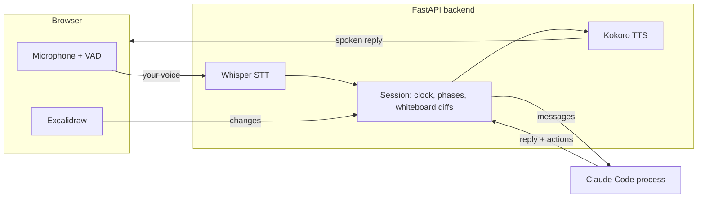

# Mocksy

**Practice technical interviews out loud, with an AI interviewer that listens, watches your whiteboard and pushes back.**

You talk and sketch, as you would in a system design round. The interviewer answers by voice,
follows your diagram as it grows, digs into the weak spots and keeps you on the clock. When
you're done, you get a written evaluation with links to the moments worth reviewing.

> Runs locally on macOS and Linux, or anywhere with Docker. The interviewer uses your own Claude Code login, no API key needed.


## Highlights


- **Voice conversation.** Hands-free turn-taking: speak, pause, and the interviewer replies out
  loud. Cut in while it's talking and it stops, knowing exactly what you heard. Push-to-talk and
  typing work too.
- **It sees your whiteboard.** An embedded [Excalidraw](https://excalidraw.com) board. The
  interviewer follows your changes as you draw, looks at the full image when it needs to, and
  checks in if you've been sketching in silence for a while.
- **Pushes back.** It answers clarifying questions with concrete numbers, probes trade-offs
  ("sequential IDs are guessable: is that a problem?"), and moves you through the phases on time.
- **An evaluation you can act on.** A verdict, a score per rubric dimension, the top 3 things to
  practice, and review notes that jump to the exact moment in the transcript. Past sessions stay
  in your history to re-read and re-listen.
- **Tailored to you.** Choose the interview type, level, target company (the interviewer can do a
  quick web search to fit the problem to it), a specific problem, or a focus such as "push me on
  failure modes". In English or Spanish.

<br clear="right">

## How it works



- **Local speech.** The browser detects when you start and stop talking. The backend transcribes
  with Whisper (MLX on Apple Silicon, faster-whisper elsewhere, on an NVIDIA GPU when there is
  one), filtering out Whisper's typical hallucinations on silence, and speaks with Kokoro. Both
  run on your machine.
- **Streaming voice.** Each session runs its own long-lived Claude Code process in stream-JSON
  mode. Replies are parsed as they stream and spoken sentence by sentence, so the interviewer
  starts talking before it has finished thinking. Short inline tags let it take notes, change
  phase, stay silent or end the interview.
- **Whiteboard as text.** Every board change becomes a diff like `+ box "Redis cache"` or
  `+ arrow box "Redirect service" → box "Redis cache"`, which is cheap enough to send on every turn. The
  rendered image is there when the model wants to look.
- **Realistic interruptions.** When you cut in, the model is told which sentences you actually
  heard, so it doesn't assume you got the rest.
- **Sandboxed.** The interviewer process runs in the session folder with a small tool allowlist,
  and without your Claude Code settings or MCP servers.
- **Evaluation.** At the end, a second, deeper model reads the transcript, the interviewer's
  notes and the whiteboard, and grades against the interview's rubric.

## Interview types

| Type | Phases |
| --- | --- |
| **System Design** (classic) | Requirements · High-level design · Deep dive · Wrap-up |
| **Product Decomposition** | Problem framing · Wireframe · System design |
| **Behavioural (STAR)** | About you · three story deep dives · Why this role · Your questions (conversation only, no whiteboard) |

Each interview type is a "pack": one Markdown file with the interviewer's brief. To add your own
(a company-specific round, frontend system design…), open **Manage types** on the home screen: create one from
scratch or duplicate a built-in, then edit its phases, rubric and brief in a form (or as raw
markdown). Packs you make there are saved in `data/packs/`, which stays out of git, so private,
company-specific prep never ships with the repo. Built-in packs live in `prompts/packs/` and are
read-only in the app; both folders can also be edited by hand.

Set `whiteboard = false` (the "Whiteboard" checkbox in the editor) for conversation-only rounds
such as behavioural interviews: the session hides the board, and neither the interviewer nor the
evaluation mentions drawing. It defaults to `true`. Editing a pack never changes an interview
already in progress: each session keeps a copy of the brief it started with.

<details>
<summary>What a pack looks like</summary>

```toml
+++
title = "System Design (classic)"
description = "Design a large-scale backend system: requirements, estimates, high-level design, deep dives."
company = ""                # optional: pre-fills the company field
default_language = "en"
whiteboard = true           # false: conversation only, no drawing board
phases = [
  { key = "requirements", label = "Requirements", minutes = 10 },
  { key = "high_level", label = "High-level design", minutes = 15 },
  { key = "deep_dive", label = "Deep dive", minutes = 20 },
  { key = "wrap_up", label = "Wrap-up", minutes = 5 },
]
rubric = ["Requirements & scoping", "Estimation", "High-level architecture", "Data model & APIs", "Scalability & reliability", "Trade-offs & communication"]
+++
You are a senior engineer running a classic system design interview. Pick a problem that fits
the target company if one is set, otherwise a well-known one...
```
</details>

## Model answer

After an evaluation, the session's **Model answer** tab turns the problem into a neutral explainer of
how to solve it well, ready to publish (on YouTube, for example):

- **Explainer video**: a narrated, animated walkthrough of about 5-6 minutes (7-8 scenes, ~750 words),
  1920x1080 at 30 fps, H.264 + AAC, with chapters. It comes with `youtube.txt` (title, description and
  chapter timestamps), the script as markdown, and a solution diagram (SVG + PNG).
- **Diagram + write-up only**: just the script step and the diagram, no video. Much cheaper and faster.

The evaluation only decides which areas get more time: the script step gets the rubric dimensions
ordered by score, never the evaluation's text, the transcript or anything personal, plus the problem as
it was posed (the opening prompt, plus the `## Scenario` section of the interviewer's notes when there is one). The output never
mentions a candidate, the interview, mistakes, scores or a verdict, and doesn't name the target company
unless you allow it in the settings. That's enforced three times: in the script prompt; by a check in code on the script and on the
scenes' on-screen text; and by the review pass, which also checks on-screen text and numbers against
the narration. The check has two tiers: unambiguous references (a candidate, an interview as a setting,
verdicts, the company) are sent back once and fail the run if they remain; ambiguous phrasing ("you said",
"a stronger answer") becomes a warning the review pass looks at. Figures the script made up are
listed as assumptions in the app, the markdown and the YouTube text.

**How it's made.** The backend runs a stage machine (Script → Diagram → Voice → Scenes → Render → QA →
Fixes), with progress, cancel, and retry from the stage that stopped. Every model step is a fresh,
bounded Claude Code process with a minimal tool set: one script worker (`opus` by default, the only
judgment step) reads the evaluation, the interviewer's notes, the interview brief and a format
reference; two scene workers (`sonnet`) each read only the scene brief, the
drawing toolkit, one reference scene and their own beats, with at most 2 still-render rounds per
scene; one review pass (`sonnet`) looks at end-of-beat frames at 960 px; one fix round, which
re-renders only the scenes it touched. Voice (Kokoro, in the session's language), rendering (headless
Chrome + ffmpeg) and packaging use no model. Workers are confined by path-scoped permission rules: each can
read only its own folder and write only its output (the scene files, `script.json`, `qa.json`); the
renderer and toolkit are read-only, and the renderer refuses more than the allowed render rounds.

**Cost.** Each run's cost and tokens are recorded, the running total is shown, and a budget cap
(default $10, API-equivalent as Claude Code reports it) stops the generation cleanly. The estimates come
from token usage measured on real runs: about $3-6.50 (typically ~$4, ~2.4M tokens, mostly cache reads)
and 17-25 minutes for an 8-scene video, and $0.40-0.90 and 2-5 minutes for the diagram only. Models per
stage, the cap, the scene count, the fix round and the company setting are under **Model answer settings**.

It's offered for rounds with a whiteboard. A pack can opt in or out with `model_answer = true/false` in
its header; the behavioural pack opts out, since a model answer of personal stories makes no sense.
Sessions recorded before this setting existed need the flag set explicitly in their pack.

**You'll need** (video only) Node, ffmpeg and Chrome: `scripts/setup.sh` installs the renderer and,
without a system Chrome or Chromium, downloads Playwright's headless Chromium. In Docker, build with
`WITH_EXPLAINER=1 docker compose up -d --build` (adds about 400 MB); the default image can still make
the diagram + write-up (SVG only).

## Getting started

There are two ways to run Mocksy: natively, or in Docker. Either way it serves
http://127.0.0.1:8765. Open it in Chrome or Safari, allow the microphone, and start an interview.

### Native (macOS or Linux)

**You'll need**
- Python 3.11, Node 24 (see `.nvmrc`) and [pnpm](https://pnpm.io)
- [Claude Code](https://claude.com/claude-code) installed and logged in (`claude` on your `PATH`)
- For model-answer videos only: ffmpeg, and Chrome (or the Chromium `scripts/setup.sh` downloads)

```sh
scripts/setup.sh   # local venv, Python deps, voice models (~1.9 GB in total)
./run.sh           # builds the web UI and serves http://127.0.0.1:8765
```

On Apple Silicon, speech-to-text runs on MLX and is fast with the large Whisper model. Elsewhere
it uses faster-whisper with the `small` model (about a second per turn on a CPU); with an NVIDIA
GPU, set `faster_whisper_model = "large-v3-turbo"` in `config.toml` for better accuracy.

### Docker (any OS, Windows included)

You only need Docker. Speech-to-text runs on the CPU inside the container, so on an Apple Silicon
Mac the native setup is snappier.

```sh
docker compose up -d --build                    # build, start, and serve http://127.0.0.1:8765
docker compose exec mocksy claude auth login    # once: open the link, sign in, paste the code back
```

Run the login in a regular terminal, since it asks you to paste the code the browser shows. It's
saved in a Docker volume, so it survives restarts and rebuilds. To use a token instead, export
`CLAUDE_CODE_OAUTH_TOKEN` (from `claude setup-token`) or `ANTHROPIC_API_KEY` in your shell before
`docker compose up`.

The first start downloads the voice model, and the first transcription downloads Whisper; both
are kept in Docker volumes. Sessions, settings and personal packs live in `./data`, the same
folder a native run uses.

| To… | Run |
| --- | --- |
| See the logs | `docker compose logs -f` |
| Stop / start | `docker compose stop` / `docker compose start` |
| Apply `config.toml` changes | `docker compose restart` |
| Update Mocksy | `git pull && docker compose up -d --build` |
| Update Claude Code | `docker compose build --no-cache && docker compose up -d` |
| Check the Claude Code login | `docker compose exec mocksy claude auth status` |

Claude Code comes from its `stable` release channel; pin a version with
`docker compose build --build-arg CLAUDE_CODE_VERSION=<version>`. To use another port, change the
first number in `ports` in `compose.yaml` (the `port` in `config.toml` only applies to native runs).
If the interviewer says "Not logged in", run the login command above.

### Configuration

`config.toml` holds the defaults; changes made from the app's settings are saved to
`data/settings.json` and take precedence. The interviewer runs on `sonnet` by default (fast enough
for conversation) and the evaluation on `opus`; both can be changed per session. The evaluation
language, voices and the Whisper models are set there too. `effort` (also under **Models** on the
home screen) is the interviewer's reasoning effort: `default` leaves it to Claude Code, `low`
answers sooner (with `haiku` it skips thinking).

In a session, the ⚙ menu sets the voice, its speed and the **pause that ends your turn**. The
default, *Adaptive*, waits 1.3 s, or 1.8 s after a short, abrupt start or a short fragment
("so I'd…"); *Adaptive, faster* also ends a long answer that trails off like a finished sentence
after 1 s (quicker replies, but it may cut a long thinking pause); fixed pauses are there too. If
you keep talking after a reply has arrived, the reply is dropped and the interviewer is told you
didn't hear it; a cough while it speaks only pauses it.
**Show response times** (or opening the app with `?debug=1`) shows how long the last reply took,
from the end of your speech to the interviewer's first audio, stage by stage.

## Development

```sh
scripts/test.sh                          # pytest + typecheck + vitest
.venv/bin/python scripts/bench_latency.py  # response-time benchmark, no microphone needed
```

The benchmark synthesises a few candidate answers with Kokoro, runs them through Whisper, a real
interviewer (`haiku` by default; `--model`, `--effort`, `--turns`, `--lang`) and the TTS worker, and
prints each stage up to "first audio ready", plus prompt-cache usage. Every live turn is also
logged by the server as a `[latency]` JSON line and stored on the candidate's message (`latency`).

**Stack:** FastAPI and Python 3.11 · React 19, Vite and TypeScript · Excalidraw ·
Whisper (mlx-whisper / faster-whisper) · Kokoro (ONNX) · Claude Code CLI.

Architecture notes, the interviewer's message protocol and the dev workflow are in
[`CLAUDE.md`](CLAUDE.md).

## Status

A personal project, built to prepare for my own interviews. It's developed and used on macOS with
Apple Silicon; Linux support is newer and less tested. Designed for a desktop browser. Next on the
list: more interview types (behavioral, frontend system design) and progress tracking across sessions.
