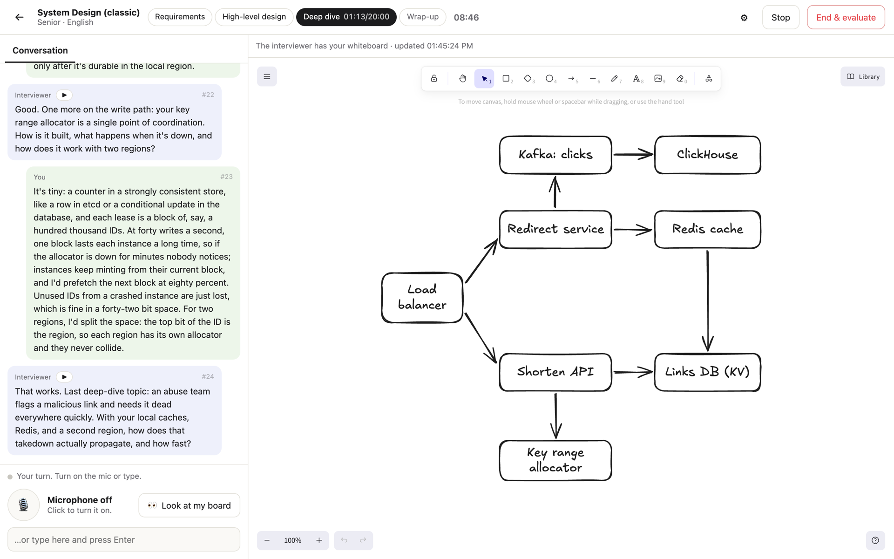
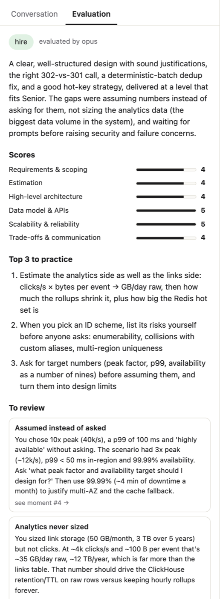
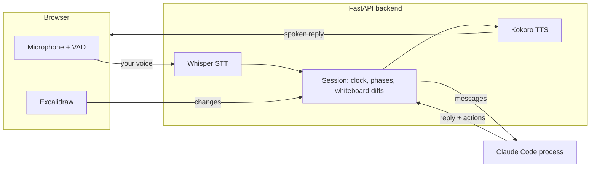

# Mocksy

**Practice technical interviews out loud, with an AI interviewer that listens, watches your whiteboard and pushes back.**

You talk and sketch, as you would in a system design round. The interviewer answers by voice,
follows your diagram as it grows, digs into the weak spots and keeps you on the clock. When
you're done, you get a written evaluation with links to the moments worth reviewing.

> Runs locally on macOS and Linux, or anywhere with Docker. The interviewer uses your own Claude Code login, no API key needed.



## Highlights



- **Voice conversation.** Hands-free turn-taking: speak, pause, and the interviewer replies out
  loud. Cut in while it's talking and it stops, knowing exactly what you heard. Push-to-talk and
  typing work too.
- **It sees your whiteboard.** An embedded [Excalidraw](https://excalidraw.com) board. The
  interviewer follows your changes as you draw, looks at the full image when it needs to, and
  checks in if you've been sketching in silence for a while.
- **Pushes back.** It answers clarifying questions with concrete numbers, probes trade-offs
  ("sequential IDs are guessable: is that a problem?"), and moves you through the phases on time.
- **An evaluation you can act on.** A verdict, a score per rubric dimension, the top 3 things to
  practice, and review notes that jump to the exact moment in the transcript. Past sessions stay
  in your history to re-read and re-listen.
- **Tailored to you.** Choose the interview type, level, target company (the interviewer can do a
  quick web search to fit the problem to it), a specific problem, or a focus such as "push me on
  failure modes". In English or Spanish.

<br clear="right">

## How it works



- **Local speech.** The browser detects when you start and stop talking. The backend transcribes
  with Whisper (MLX on Apple Silicon, faster-whisper elsewhere, on an NVIDIA GPU when there is
  one), filtering out Whisper's typical hallucinations on silence, and speaks with Kokoro. Both
  run on your machine.
- **Streaming voice.** Each session runs its own long-lived Claude Code process in stream-JSON
  mode. Replies are parsed as they stream and spoken sentence by sentence, so the interviewer
  starts talking before it has finished thinking. Short inline tags let it take notes, change
  phase, stay silent or end the interview.
- **Whiteboard as text.** Every board change becomes a diff like `+ box "Redis cache"` or
  `+ arrow box "Redirect service" → box "Redis cache"`, which is cheap enough to send on every turn. The
  rendered image is there when the model wants to look.
- **Realistic interruptions.** When you cut in, the model is told which sentences you actually
  heard, so it doesn't assume you got the rest.
- **Sandboxed.** The interviewer process runs in the session folder with a small tool allowlist,
  and without your Claude Code settings or MCP servers.
- **Evaluation.** At the end, a second, deeper model reads the transcript, the interviewer's
  notes and the whiteboard, and grades against the interview's rubric.

## Interview types

| Type | Phases |
| --- | --- |
| **System Design** (classic) | Requirements · High-level design · Deep dive · Wrap-up |
| **Product Decomposition** | Problem framing · Wireframe · System design |

Each interview type is a "pack": one Markdown file with the interviewer's brief. To add your own
(behavioral, frontend system design…), drop a file into `prompts/packs/`. Private packs, such as
company-specific prep, go in `data/packs/`, which stays out of git.

<details>
<summary>What a pack looks like</summary>

```toml
+++
title = "System Design (classic)"
description = "Design a large-scale backend system: requirements, estimates, high-level design, deep dives."
phases = [
  { key = "requirements", label = "Requirements", minutes = 10 },
  { key = "high_level", label = "High-level design", minutes = 15 },
  { key = "deep_dive", label = "Deep dive", minutes = 20 },
  { key = "wrap_up", label = "Wrap-up", minutes = 5 },
]
rubric = ["Requirements & scoping", "Estimation", "High-level architecture", "Data model & APIs", "Scalability & reliability", "Trade-offs & communication"]
+++
You are a senior engineer running a classic system design interview. Pick a problem that fits
the target company if one is set, otherwise a well-known one...
```
</details>

## Getting started

**You'll need**
- macOS or Linux (on Windows, use WSL or Docker).
  Apple Silicon or an NVIDIA GPU makes transcription fastest; on a plain CPU, set
  `faster_whisper_model = "small"` in `config.toml` for snappier turns.
- Python 3.11, Node 24 (see `.nvmrc`) and [pnpm](https://pnpm.io)
- [Claude Code](https://claude.com/claude-code) installed and logged in (`claude` on your `PATH`)

```sh
scripts/setup.sh   # local venv, Python deps, voice models (~1.9 GB in total)
./run.sh           # builds the web UI and serves http://127.0.0.1:8765
```

Open http://127.0.0.1:8765 in Chrome or Safari, allow the microphone, and start an interview.

### Or with Docker

Any OS with Docker works, Windows included. Speech-to-text runs on the CPU inside the container
(about a second per turn), so on an Apple Silicon Mac the native setup above is snappier.

```sh
docker compose up -d --build                        # http://127.0.0.1:8765
docker compose exec mocksy claude auth login        # once: open the link, paste the code back
```

Run the login in a regular terminal: it asks you to paste back the code the browser shows.

The login is kept in a Docker volume, so it survives restarts and rebuilds. To use a token
instead, export `CLAUDE_CODE_OAUTH_TOKEN` (from `claude setup-token`) or `ANTHROPIC_API_KEY`
in your shell before `docker compose up`.

The first start downloads the voice model and the first transcription the Whisper weights; both
are kept in volumes, as are your sessions. `config.toml` is mounted read-only, so you can change
models or voices and just `docker compose restart`.

By default the interviewer runs on `sonnet` (fast enough for conversation) and the evaluation on
`opus`. Both can be changed per session. Defaults for models, voices, evaluation language and
port live in `config.toml`.

## Development

```sh
scripts/test.sh    # pytest + typecheck + vitest
```

**Stack:** FastAPI and Python 3.11 · React 19, Vite and TypeScript · Excalidraw ·
Whisper (mlx-whisper / faster-whisper) · Kokoro (ONNX) · Claude Code CLI.

Architecture notes, the interviewer's message protocol and the dev workflow are in
[`CLAUDE.md`](CLAUDE.md).

## Status

A personal project, built to prepare for my own interviews. It's developed and used on macOS with
Apple Silicon; Linux support is newer and less tested. Designed for a desktop browser. Next on the
list: more interview types (behavioral, frontend system design) and progress tracking across sessions.
